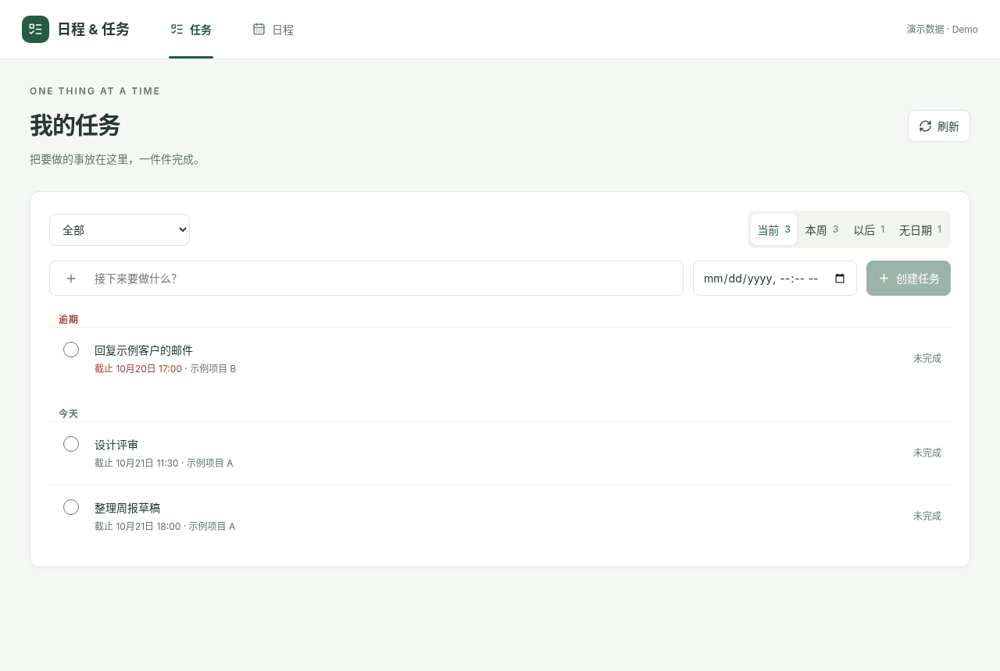
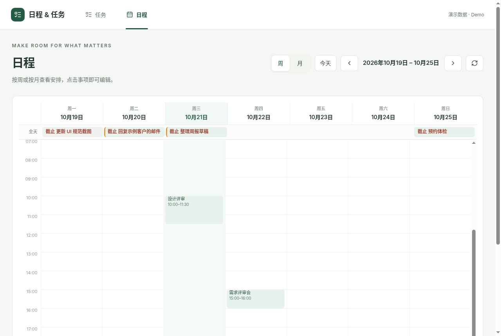

# 日程 & 任务 UI · hub-calendar-tasks-ui

一个个人工作台里的「任务」和「日程」两页前端，附带一套 UI 设计规范。数据全部来自内置的 Mock 层（虚构示例数据，存在内存里，刷新即重置），**不需要任何后端**。

The task (`/work`) and calendar (`/calendar`) pages of a personal dashboard, plus a UI design spec. Runs standalone on a built-in in-memory mock API — no backend needed.




## 功能 Features

- **任务 `/work`**：分段「当前（今天 + 逾期）/ 本周 / 以后 / 无日期」；按领域分组的项目下拉框；已完成任务折叠成一行；右侧编辑面板。
- **日程 `/calendar`**：周视图 / 月视图，在时间格上拖拽即可创建日程，点击打开编辑。
- 技术栈 Stack：React 19 + TypeScript + Vite + TanStack Query + Tailwind CSS 4 + lucide-react。

## 运行 Run

```bash
npm install
npm run dev     # http://localhost:3000
npm run build   # 类型检查 + 打包
npm test        # 工具函数单元测试
```

需要 Node.js 20+。Requires Node.js 20+.

## 接入真实后端 Use a real backend

Mock 在 `src/api/client.ts`（接口实现）和 `src/api/mockData.ts`（示例数据）。把 `client.ts` 换成普通的 `axios.create({ baseURL })`，后端实现同样的接口即可：

| 方法 | 路径 | 说明 |
| --- | --- | --- |
| GET | `/api/projects` | 项目列表 `{ data: Project[] }` |
| GET | `/api/tasks?from=&to=` | 任务列表 `{ data: Task[], total }` |
| POST | `/api/tasks` | 新建任务 |
| PATCH | `/api/tasks/:id` | 修改任务 |
| DELETE | `/api/tasks/:id` | 删除任务 |

## UI 规范 UI spec

见 [`ui-spec/`](../ui-spec/)：

- [`ui-spec/docs/06-frontend.md`](../ui-spec/docs/06-frontend.md)：前端工程规范
- [`ui-spec/docs/07-design-system/`](../ui-spec/docs/07-design-system/README.md)：设计系统（原则、令牌、布局与对齐、组件、交互、文案、无障碍、审查清单）
- [`ui-spec/templates/design-tokens.css`](../ui-spec/templates/design-tokens.css)：可直接复制使用的设计令牌

## 许可 License

[MIT](../LICENSE)
